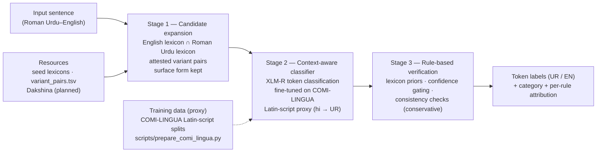

# Ru–En Token-Level LID — Variation-Aware, Ambiguity-Aware Pipeline

[](https://github.com/Mughal-Hash-24/RU-EN-LID/actions/workflows/tests.yml)

**Iteration 1 — implementation of the proposed methodology.**
This repository turns the proposed pipeline (candidate expansion → context-aware classifier → rule-based
verification) into working code and demonstrates it end-to-end on a small hand-labelled slice. Stage 2 is
trained on proxy data (the Latin-script part of COMI-LINGUA) and runs inside the pipeline; results are in
[`results/iteration1_results.md`](results/iteration1_results.md).

---

## 1. Topic and problem statement

Roman Urdu is Urdu written in the Latin script with no fixed spelling standard. In Roman Urdu–English
code-mixed text, token-level language identification (labelling every word as Urdu or English) is hard for
two distinct reasons that prior work never separates:

- **Cross-lingual lexical ambiguity** — one form, two languages: *main* ("I" / English *main*), *band*
  ("closed" / musical band), *is*, *to*.
- **Orthographic variation** — one word, many spellings: *nahi / nai / nhi*, *hai / he / hy*.

Existing studies show LID degrades on code-mixed input but do not isolate either error source, so errors
cannot be attributed to a cause and every downstream code-mixing analysis rests on unmeasured label error.
The proposed pipeline targets both, and reports error shares **per cause** (ambiguity / spelling variation /
their overlap).

## 2. What this iteration implements

| Stage | Proposal step | Status in this repository |
|---|---|---|
| 1 | Candidate expansion (surface form kept, readings attached, never rewritten) | **Working** — lexicons, attested variant pairs, four-category taxonomy, per-token candidate sets |
| 2 | Context-aware classifier (fine-tuned multilingual encoder) | **Trained (proxy data)** — XLM-R base fine-tuned on 6,540 Latin-script COMI-LINGUA sentences (hi → UR), per-epoch validation, inference wrapper; augmentation implemented, not yet used; Stage 1 candidate conditioning is the iteration-2 ablation rung (§10.1) |
| 3 | Rule-based verification (priors, confidence gating, consistency) | **Working** — conservative rules with per-token action log |
| 4 | Evaluation (per-category metrics, error attribution, CMI) | **Working** — metrics module + report script + learning-curve runner + MixLID baseline adapter |

Stages 1, 3 and the evaluation harness run on the **Python standard library alone** — no GPU, no
downloaded models. Stage 2 requires `torch`/`transformers`/`accelerate` and a trained checkpoint; see §7.

## 3. Architecture



## 4. Repository layout

```
ruen-lid-pipeline/
├── README.md                  # this file
├── METHODOLOGY_TO_CODE.md     # required step → file/function mapping
├── LICENSE                    # MIT for the code; data/model licences are noted in §11
├── requirements.txt           # Stage-2 training dependencies
├── .github/workflows/tests.yml # standard-library test suite (Python 3.10/3.12/3.13)
├── data/
│   ├── README.md              # dataset links, licences, roles
│   ├── fetch_data.py          # downloads into data/cache (never committed)
│   ├── resources/             # seed English + Roman Urdu lexicons, variant_pairs.tsv
│   └── demo/
│       ├── seed_labels.csv    # hand-labelled demo slice (12 sentences / 51 tokens)
│       └── running_examples.csv # proposal's two running examples (25 tokens)
├── src/
│   ├── candidate_expansion/   # Stage 1
│   ├── classifier/            # Stage 2 (dataset, augment, train, predict)
│   ├── verification/          # Stage 3
│   ├── eval/                  # metrics + baseline adapters
│   └── pipeline.py            # end-to-end CLI
├── scripts/
│   ├── evaluate.py            # token-level evaluation + markdown report
│   ├── prepare_comi_lingua.py # Stage-2 proxy data: COMI-LINGUA Latin-script splits
│   ├── learning_curve.py      # Stage-2 learning curve (subset sizes × seeds) + scoring
│   └── train_poc.py           # Stage-2 entry point (dry-run / smoke / real)
├── tests/test_pipeline.py     # 15 unit tests (stdlib unittest)
├── results/
│   ├── seed_results.md        # demo-slice evaluation in fallback mode (before Stage 2 was trained)
│   ├── iteration1_results.md  # trained Stage 2 vs fallback, learning curve, Stage 3 effect
│   └── learning_curve/        # learning-curve summary.md + runs.json
└── checkpoints/               # trained models (git-ignored)
```

## 5. Setup

**Stages 1/3/CLI/evaluation — no setup required** (Python ≥ 3.10, standard library only).

**Stage 2 training** needs a virtualenv on a Python version with PyTorch wheels (none for 3.14 yet; the
iteration-1 model was trained on Python 3.13 with torch 2.11 + CUDA). `requirements.txt` includes
`accelerate`, which the Hugging Face `Trainer` requires:

```bash
python3.13 -m venv .venv   # 3.13 was used for the iteration-1 run; 3.10–3.13 all work
source .venv/bin/activate
pip install -r requirements.txt
```

## 6. Quick start

```bash
# End-to-end pipeline on the running example (heuristic fallback, no checkpoint)
python3 -m src.pipeline --text "Delivery to time pe hui but box band nhi tha, main bht upset hoon, is bar bhi same issue he."

# The same with the trained Stage-2 model from Hugging Face (§7; ~1.1 GB, downloaded on first use)
python3 -m src.pipeline --checkpoint OmarNiazi/ruen-lid-xlmr-base-iter1 --text "Delivery to time pe hui but box band nhi tha, main bht upset hoon, is bar bhi same issue he."

# Unit tests (15 tests)
python3 -m unittest discover -s tests

# Evaluation on the hand-labelled demo slice -> results/seed_results.md (fallback)
python3 scripts/evaluate.py --out results/seed_results.md

# The same evaluation with the trained model
python3 scripts/evaluate.py --checkpoint OmarNiazi/ruen-lid-xlmr-base-iter1

# Data pipeline + augmentation statistics (no torch required)
python3 scripts/train_poc.py --dry-run

# Known datasets, licences and download status
python3 data/fetch_data.py --list
```

Example pipeline output (fallback mode, abbreviated):

```
token      category    readings   label  conf  rules
Delivery   standard    EN         EN     0.9
band       ambiguous   EN/band    EN     0.3
nhi        variant     nahi       UR     0.4
bar        both        EN/baar    UR     0.4
he         both        EN/hai     UR     0.4
```

With the trained checkpoint (abbreviated; the ambiguous *band* is now resolved from context):

```
token      category    readings   label  conf   rules
Delivery   standard    EN         EN     0.998
band       ambiguous   EN/band    UR     1.0
nhi        variant     nahi       UR     1.0
bar        both        EN/baar    UR     0.999
he         both        EN/hai     UR     0.984
```

## 7. Stage-2 training (proxy data)

The training pipeline is language-agnostic. No Roman Urdu–English corpus carries word-level LID labels (that
is exactly why the proposal schedules a manual annotation phase), so for this iteration Stage 2 is trained on
**proxy, publicly available token-level LID data**: the **Latin-script part of COMI-LINGUA**, a Hindi–English
corpus with expert word-level labels. Romanized Hindi is labelled Hindi there (not English) and shares the
everyday words of Roman Urdu (*hai, nahi, ko, ki, se*), so `hi` maps to UR. An RU–EN checkpoint follows the
annotation phase.

```bash
# 1. Proxy token-level LID data (Hi-En, COMI-LINGUA; ~146 MB)
python3 data/fetch_data.py --dataset comi-lingua-lid --yes-large

# 2. Latin-script train / valid / test splits, plus nested subsets for the learning curve
python3 scripts/prepare_comi_lingua.py --subsets 1000,2000,5000

# 3a. One training run (XLM-R as proposed; MuRIL is the documented alternative)
python3 -m src.classifier.train \
  --train data/cache/comi-lingua-lid/roman/train.csv \
  --valid data/cache/comi-lingua-lid/roman/valid.csv \
  --model xlm-roberta-base --epochs 5 --batch-size 16 --learning-rate 3e-5 \
  --warmup-ratio 0.1 --weight-decay 0.01 --max-length 256 --bf16 --select-best \
  --out checkpoints/run1

# 3b. Or the learning curve: 1k / 2k / 5k / all training sentences x 3 seeds, each scored on the
#     test split; keeps the best full-data model in checkpoints/ruen-lid
python3 scripts/learning_curve.py

# 4. Inference with a trained checkpoint (a Hugging Face id or a local folder)
python3 -m src.pipeline --text "kal office jana hai" --checkpoint OmarNiazi/ruen-lid-xlmr-base-iter1
```

**Trained checkpoint.** The iteration-1 model, the best full-data learning-curve run, is public on Hugging
Face: [`OmarNiazi/ruen-lid-xlmr-base-iter1`](https://huggingface.co/OmarNiazi/ruen-lid-xlmr-base-iter1).
It's licensed CC BY-SA 4.0, following the COMI-LINGUA training data, and its model card has the results and
the proxy-data caveat. `--checkpoint` accepts that id (downloaded once, ~1.1 GB) or a local folder such as
`checkpoints/ruen-lid`, which is where step 3b writes it.

**Proxy splits** (`scripts/prepare_comi_lingua.py`):
- the gold label is the 2-of-3 annotator majority; words without one are labelled `IGN` (kept as context,
  never trained on or scored);
- only Latin-script sentences are kept;
- training sentences that also occur in the test file are removed (4,107 of its 4,944 usable sentences are
  duplicated in COMI-LINGUA's train file);
- words are re-split with the pipeline tokenizer, so training and inference see the same tokens;
- the result is 6,540 train / 727 valid / 750 test sentences.

**Augmentation (proposal §7.2):** spelling variation is synthesized rule-by-rule
(`src/classifier/augment.py:synthetic_variants`), while ambiguity cannot be synthesized and is covered by
oversampling real sentences that contain known ambiguous forms (`oversample_ambiguous`). Both are implemented
and the dry-run prints their statistics, but `train.py` does not use them yet (next iteration).

## 8. Evaluation protocol

Implemented in `src/eval/metrics.py`:

- token accuracy and macro-F1, overall and **per category** (standard / ambiguous / variant / both);
- **error share by cause** — what fraction of errors sit on ambiguous tokens, on variant tokens, and on
  their overlap;
- **CMI** (Gambäck & Das, 2014) with the length normalization `100·(1−Σpₗ²)/(1−1/n)`;
- words labelled `IGN` (no annotator majority) are left out of every score and reported as `ignored`;
- **stage-wise comparison**: `scripts/evaluate.py --checkpoint … --tau 0` scores Stage 2 alone (no rule can
  fire); the default τ scores Stage 2 + Stage 3;
- categories: the demo slice carries gold categories; COMI-LINGUA has none, so its per-category report uses
  Stage 1's form-level categories, including `unknown` for words outside the seed lexicons;
- baseline adapters (`src/eval/baselines/`): the model-free fallback, plus an off-the-shelf **MixLID**
  adapter (2026 token-level LID model; its label inventory has `urd_Arab` but **no `urd_Latn`**, so it
  cannot label Latin-script Urdu — the adapter reports this failure mode).

## 9. Results — iteration 1

Full write-up: [`results/iteration1_results.md`](results/iteration1_results.md). These are **proxy-data
results, not yet a Roman Urdu result** (see §10).

**Trained Stage 2 vs the fallback** (accuracy · macro F1):

| Test set | Fallback (no Stage-2 model) | Trained Stage 2 + Stage 3 |
|---|---|---|
| Demo slice (12 sentences / 51 tokens, gold categories) | 0.8235 · 0.7984 (9 errors) | 1.0000 · 1.0000 (0 errors) |
| Proposal's running examples (25 tokens) | 19 / 25 | 25 / 25 |
| COMI-LINGUA Latin-script test (750 sentences / 15,207 tokens) | 0.4191 · 0.4027 | 0.9617 · 0.9352 |

**Learning curve** (COMI-LINGUA test, Stage 2 alone, mean of 3 seeds; accuracy standard deviation ≤ 0.0016):

| Training sentences | 1,000 | 2,000 | 5,000 | 6,540 |
|---|---|---|---|---|
| Token accuracy | 0.9501 | 0.9547 | 0.9631 | 0.9631 |
| Macro F1 | 0.9157 | 0.9238 | 0.9378 | 0.9374 |

The curve levels off between 5,000 and 6,540 training sentences. Stage 3 changes almost nothing with the
trained model: on the COMI-LINGUA test split it changed 1 of 15,207 tokens at τ = 0.55, and that change was
wrong, because only 0.5% of tokens fall below τ.

The 25-token running-example slice is committed as `data/demo/running_examples.csv`; reproduce that row
with `python3 scripts/evaluate.py --data data/demo/running_examples.csv --checkpoint OmarNiazi/ruen-lid-xlmr-base-iter1`.

### Fallback mode (before Stage 2 was trained)

From `results/seed_results.md` (12 sentences, 51 tokens; **demo, not a thesis result**):

| Metric | Value |
|---|---|
| Token accuracy | 0.8235 |
| Macro F1 | 0.7984 |
| CMI (gold labels, corpus-level) | 38.75 |
| Errors | 9 |

| Category | Tokens | Accuracy | Macro F1 |
|---|---|---|---|
| standard | 34 | 1.0000 | 1.0000 |
| variant | 6 | 1.0000 | 1.0000 |
| both | 3 | 0.6667 | 0.4000 |
| ambiguous | 8 | 0.0000 | 0.0000 |

| Cause | Share of all errors |
|---|---|
| ambiguity | 88.89% |
| both (ambiguity × variation overlap) | 11.11% |

**Interpretation.** In fallback mode the entire residual error sits on ambiguous tokens and their overlap,
because the fallback labels every ambiguous form EN and every "both" form UR (Stage 3 changed no label). The
trained context classifier resolves all of these on the demo slice (8/8 ambiguous, 3/3 both), and 216 of 223
ambiguous-category tokens on the COMI-LINGUA test split.

## 10. Iteration-1 scope, deviations and limits

Documented deviations, each deliberate and justified:

1. **Stage 2 is trained on proxy data**: the Latin-script part of COMI-LINGUA (Hindi–English, `hi` → UR),
   after removing test sentences that are duplicated in its train file. Romanized Hindi shares Roman Urdu's
   everyday words, but the §9 numbers are proxy results; RU–EN training and evaluation require the seed
   annotation from the proposal's P1–P2 phase.
2. **Heuristic fallback** is used by the CLI/evaluation only when no `--checkpoint` is given: variants → UR,
   ambiguous → EN (low confidence), then Stage-3 rules run. The fallback is clearly labelled in output
   and is not presented as the methodology's classifier.
3. **Variant pairs are attested (seeded)** rather than mined at scale; `cluster_variants` (UrduPhone-style
   phonetic clustering) is included as the discovery tool for expanding `variant_pairs.tsv` with Dakshina
   attestations.
4. **Seed lexicons are compact** (hundreds of words). Production runs point the loader at full English and
   Roman Urdu lexicons (`--resources` / custom files).
5. **Stage-2 training was executed** on Python 3.13 / torch 2.11 with an RTX 4070 Laptop GPU (12
   learning-curve runs in 41 minutes). The smoke mode's tiny test model
   (`hf-internal-testing/tiny-random-XLMRobertaForTokenClassification`) is no longer on Hugging Face, so
   `--smoke` currently fails; real runs are unaffected.
6. **MixLID baseline adapter is included but not executed** here (requires `transformers`); it is the
   planned modern baseline, and its missing `urd_Latn` label is itself evidence for the research gap.
7. **Unresolved annotations are labelled `IGN`.** COMI-LINGUA words on which all three annotators disagree
   (mostly ambiguous forms such as *to, me, he, is*) are kept as context but excluded from training and
   scoring; dropping their sentences instead would remove 15% of the training and 23% of the test sentences.
8. **A third label, `OTH`** (names, mentions, URLs), is kept from the proxy data; the proposal's task is UR/EN.
9. **Stage 2 does not yet receive Stage 1's candidate readings** (the proposal's input is surface form +
   readings + context), so the ablation rungs "plain encoder" and "+ candidate expansion" currently coincide.
   This is the deliberate iteration-1 scope; §10.1 gives the methodological justification.
10. **Augmentation is implemented but not yet used in training** (§7).
11. **Stage 3 has almost no effect with the trained model** (§9): its rules only re-check tokens below τ, and
    the classifier is rarely that unsure. §10.2 explains why this is the expected outcome of the proposal's
    conservative design, not a missing stage.

### 10.1 Why Stage 1 is implemented but not yet conditioned into Stage 2

The proposal defines Stage 2's input as *surface form + candidate readings + sentence context*, and
explicitly leaves *the exact encoding of candidates* as an implementation choice to be settled by ablation
(§7.2). The evaluation plan is an ablation ladder: plain encoder → + candidate expansion → + verification
(§8). Iteration 1 implements the **first rung**. Comparing a candidate-conditioned encoder against an
unmeasured plain-encoder baseline would confound the two stages, so the baseline is trained and reported
first.

Stage 1 is not missing. `CandidateExpander` produces the four-category taxonomy, the English reading, and
the Urdu canonical form(s) for every token, and `LIDPipeline.run()` already holds those `TokenCandidates`
when it calls the classifier. What is deferred is one specific encoding step: turning those readings into
classifier features. That is the **+ candidate expansion** rung of the ablation, not a new pipeline stage.

Two properties of the iteration-1 data make the deferral the correct call:

1. **The proxy corpus cannot support a fair test of candidate conditioning.** 10,156 of the 15,207
   COMI-LINGUA test tokens (67%) are outside the seed lexicons, and COMI-LINGUA has no gold four-category
   labels. A feature-conditioned model trained now would mostly measure lexicon coverage, not the effect of
   handling ambiguity and spelling variation.
2. **The proposal's P1–P2 annotation is the prerequisite for a meaningful RU–EN test.** Candidate
   conditioning must be selected and evaluated on Roman Urdu–English gold categories, not on a proxy with
   no category labels. The current seed slice is a sanity check (51 tokens), not a model-selection set.

Iteration 2 adds the candidate-conditioned encoder and reports the plain-encoder vs + candidate-expansion
rung on identical splits, with the augmentation from `src/classifier/augment.py` in training. The handoff
point is already explicit in the code, so this is an additive change rather than a redesign.

### 10.2 Why Stage 3 is conservative and currently changes almost nothing

Proposal §7.3 requires Stage 3 to be deliberately conservative so that verification cannot become a new
error source. The implementation follows that requirement literally: a rule fires only when the classifier
is below τ, and only for three narrow cases (variant consistency, English-lexicon prior, Urdu-lexicon
prior). With the proxy-trained model, only 73 of 15,207 test tokens fall below τ = 0.55; Stage 3 changes one
label and that change is wrong.

That is the result the ablation is designed to expose, not a missing component. `apply_rules()` is wired
into the pipeline, records per-token attributions, and is measured at τ = 0 (off), 0.55 (default), and 0.75
in `results/iteration1_results.md` §3.5. The negative result supports the proposal's risk mitigation: when
the context classifier is confident, conservative rules have little to correct, and aggressive rules would
introduce errors. Iteration 2 revisits the rules after RU–EN retraining and reports whether Stage 3 earns
its place in the ladder.

### 10.3 What iteration 1 claims — and what it does not

**Claims.** The three-stage pipeline is implemented end to end and mapped to files/functions; Stage 1
produces per-token candidate readings without rewriting the surface form; Stage 2 trains, validates, and
runs inside the pipeline; Stage 3 is implemented, configurable, and ablated; evaluation reports
per-category accuracy/F1, error attribution, and CMI; the training path is reproducible and a public
checkpoint/model card is available.

**Does not claim.** Roman Urdu–English performance (the training data is a Latin-script Hindi–English
proxy); a measured causal gain from Stage 1 (that is iteration 2's + candidate-expansion rung); a positive
contribution from Stage 3 (the iteration-1 finding is that it is near-zero); full baselines, annotation, or
CMI-band analysis.

This scope matches the implementation rubric: full results are not required while the work is in progress;
a working core implementation, mapped to the methodology and documented, is.

## 11. Datasets

See [`data/README.md`](data/README.md) for the full table (roles, licences, links). No corpus is
redistributed; `fetch_data.py` downloads into the git-ignored `data/cache/`.

The **code** is MIT-licensed (`LICENSE`). COMI-LINGUA and the proxy checkpoint derived from it are
CC BY-SA 4.0; the model card records that. Other datasets keep their own licences (see `data/README.md`).

## 12. Methodology → code mapping

The required step-by-step mapping table lives in [`METHODOLOGY_TO_CODE.md`](METHODOLOGY_TO_CODE.md).

## 13. Roadmap (next iterations)

1. Annotation guidelines and pilot annotation with per-category κ (proposal P1).
2. Full annotation of the RU–EN evaluation sample (P2).
3. Replace seed lexicons with full lexicons + Dakshina attestation mining; add the ambiguous/"both" forms
   found in COMI-LINGUA (*me, or, bat, use, hi*).
4. Train the XLM-R classifier on the annotated RU–EN data (P3); proxy-data training is done (§7, §9).
5. Feed Stage 1's candidate readings into the classifier and use the augmentation in training, so the
   ablation ladder can separate the stages; revisit Stage 3 for a confident classifier.
6. Run baselines (off-the-shelf tools, MixLID, LLMs) and the ablation ladder (P5–P6).
7. Error-share-by-cause and CMI-band analysis (per-sentence CMI); report per-category results (P6).

## 14. Iteration-1 submission checklist (rubric)

| Rubric requirement | Where it is satisfied |
|---|---|
| README: topic and problem statement | §1 |
| README: workflow / architecture diagram | §3 |
| README: setup and run instructions | §5–§7 |
| README: summary of results | §9; `results/iteration1_results.md` |
| Source code organized by methodology step | `src/candidate_expansion/`, `src/classifier/`, `src/verification/`, `src/eval/`, `src/pipeline.py` |
| Dataset/input details, links, no large files | §11; `data/README.md` |
| Dependencies and reproducibility | `requirements.txt`; §5–§7; public checkpoint [`OmarNiazi/ruen-lid-xlmr-base-iter1`](https://huggingface.co/OmarNiazi/ruen-lid-xlmr-base-iter1); `scripts/prepare_comi_lingua.py`; `scripts/learning_curve.py` |
| Methodology-to-code mapping | `METHODOLOGY_TO_CODE.md` |
| Public repository | https://github.com/Mughal-Hash-24/RU-EN-LID |
| Tests / CI | `tests/test_pipeline.py`; `.github/workflows/tests.yml` |
| License | `LICENSE` (MIT for code; data/model licences in §11) |

## 15. References

- Rafae et al., *A clustering framework for lexical normalization of Roman Urdu*, Natural Language Engineering, 2021.
- Benton et al., *Improving informally romanized language identification*, EMNLP, 2025.
- Sheth et al., *COMI-LINGUA: Expert annotated large-scale dataset for multitask NLP in Hindi-English code-mixing*, Findings of EMNLP, 2025.
- Gambäck & Das, *On measuring the complexity of code-mixing*, ICON, 2014.
- Hong et al., *MixLID: Token-level language identification in mixed-language text*, 2026 ([model](https://huggingface.co/nlpai-lab/MixLID)).
- Burchell et al., *Code-switched language identification is harder than you think*, EACL, 2024.
- Kargaran et al., *MaskLID: Code-switching language identification through iterative masking*, ACL, 2024.
- Kitamura et al., *Doppelganger-JC: Benchmarking LLMs' understanding of cross-lingual homographs*, IJCNLP-AACL, 2025.
- Jamil & Rafi, *Code-switching as a safety failure mode in large language models*, AbjadNLP, 2026.
