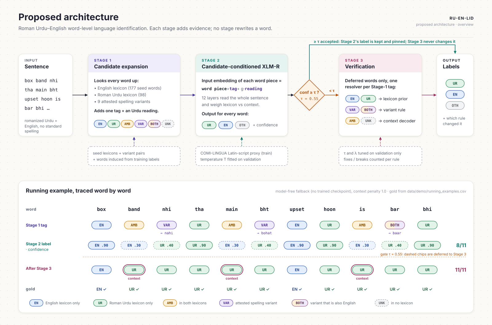

# Ru–En Token-Level LID — Variation-Aware, Ambiguity-Aware Pipeline

[](https://github.com/Mughal-Hash-24/RU-EN-LID/actions/workflows/tests.yml)

**Iteration 1 — implementation of the proposed methodology.**
This repository turns the proposed pipeline (candidate expansion → context-aware classifier → rule-based
verification) into working code and demonstrates it end-to-end on a small hand-labelled slice. Stage 2 is
trained on proxy data (the Latin-script part of COMI-LINGUA) and runs inside the pipeline; results are in
[`results/iteration1_results.md`](results/iteration1_results.md).

---

## 1. Topic and problem statement

Roman Urdu is Urdu written in the Latin script with no fixed spelling standard. In Roman Urdu–English
code-mixed text, token-level language identification (labelling every word as Urdu or English) is hard for
two distinct reasons that prior work never separates:

- **Cross-lingual lexical ambiguity** — one form, two languages: *main* ("I" / English *main*), *band*
  ("closed" / musical band), *is*, *to*.
- **Orthographic variation** — one word, many spellings: *nahi / nai / nhi*, *hai / he / hy*.

Existing studies show LID degrades on code-mixed input but do not isolate either error source, so errors
cannot be attributed to a cause and every downstream code-mixing analysis rests on unmeasured label error.
The proposed pipeline targets both, and reports error shares **per cause** (ambiguity / spelling variation /
their overlap).

## 2. What this iteration implements

| Stage | Proposal step | Status in this repository |
|---|---|---|
| 1 | Candidate expansion (surface form kept, readings attached, never rewritten) | **Working** — lexicons, attested variant pairs, four-category taxonomy, per-token candidate sets |
| 2 | Context-aware classifier (fine-tuned multilingual encoder) | **Trained (proxy data)** — XLM-R base fine-tuned on 6,540 Latin-script COMI-LINGUA sentences (hi → UR), per-epoch validation, inference wrapper; augmentation implemented, not yet used; **+ Stage 1 conditioning** (evidence tag and Urdu reading in the input embedding, `--candidates`) trained and compared with the plain encoder in `experiments/03_stage1_to_stage2` (§10.4) |
| 3 | Rule-based verification (priors, confidence gating, consistency) | **Working** — conservative rules with per-token action log; threshold τ selected on validation data (`scripts/tune_tau.py`, §8) |
| 4 | Evaluation (per-category metrics, error attribution, CMI) | **Working** — metrics module + report script + learning-curve runner + MixLID baseline adapter |

Stages 1, 3 and the evaluation harness run on the **Python standard library alone** — no GPU, no
downloaded models. Stage 2 requires `torch`/`transformers`/`accelerate` and a trained checkpoint; see §7.

## 3. Architecture



Stage 1 tags each word from the lexicons without rewriting it; Stage 2 (XLM-R) reads the sentence with
those tags and gives each word UR, EN or OTH with a confidence; words below the gate τ go to Stage 3,
which applies one resolver per tag. Detailed diagrams for each stage: [docs/architecture](docs/architecture/README.md).

## 4. Repository layout

```
ruen-lid-pipeline/
├── README.md                  # this file
├── METHODOLOGY_TO_CODE.md     # required step → file/function mapping
├── LICENSE                    # MIT for the code; data/model licences are noted in §11
├── requirements.txt           # Stage-2 training dependencies
├── .github/workflows/tests.yml # standard-library test suite (Python 3.10/3.12/3.13)
├── docs/architecture/         # proposed-architecture diagrams (SVG + 2x PNG), built by scripts/make_architecture_diagrams.py
├── data/
│   ├── README.md              # dataset links, licences, roles
│   ├── fetch_data.py          # downloads into data/cache (never committed)
│   ├── resources/             # seed English + Roman Urdu lexicons, variant_pairs.tsv
│   └── demo/
│       ├── seed_labels.csv    # hand-labelled demo slice (12 sentences / 51 tokens)
│       └── running_examples.csv # proposal's two running examples (25 tokens)
├── src/
│   ├── candidate_expansion/   # Stage 1 (+ lexicons induced from training labels)
│   ├── classifier/            # Stage 2 (dataset, augment, train, predict, Stage-1 features, candidate model, calibrate)
│   ├── verification/          # Stage 3 (rules, context decoder, threshold selection)
│   ├── eval/                  # metrics, selective evaluation, calibration, baseline adapters
│   └── pipeline.py            # end-to-end CLI
├── scripts/
│   ├── evaluate.py            # token-level evaluation + markdown report
│   ├── prepare_comi_lingua.py # Stage-2 proxy data: COMI-LINGUA Latin-script splits
│   ├── check_split_overlap.py # checks that train / valid / test share no sentences
│   ├── learning_curve.py      # Stage-2 learning curve (subset sizes × seeds) + scoring
│   ├── tune_tau.py            # Stage-3 threshold τ selected on validation -> <checkpoint>/stage3.json
│   ├── tune_stage3.py         # Stage-3 grid over τ × context penalty on validation
│   ├── build_lexicon.py       # Stage-1 resource folder: seeds + words induced from the training split
│   ├── make_architecture_diagrams.py # docs/architecture/*.svg from the pipeline
│   └── train_poc.py           # Stage-2 entry point (dry-run / smoke / real)
├── experiments/               # side experiments (Devanagari sentences, longer training, Stage 1 → Stage 2 ablation)
├── tests/                     # 65 unit tests (stdlib unittest; the 6 model tests need torch)
├── results/
│   ├── seed_results.md        # demo-slice evaluation in fallback mode (before Stage 2 was trained)
│   ├── iteration1_results.md  # trained Stage 2 vs fallback, learning curve, Stage 3 effect
│   ├── learning_curve/        # learning-curve summary.md + runs.json
│   ├── split_overlap.json     # overlap counts between the proxy splits
│   └── stage3_tau/            # τ selection: summary.md + sweep.json + sweep.csv + zoom.csv
└── checkpoints/               # trained models (git-ignored)
```

## 5. Setup

**Stages 1/3/CLI/evaluation — no setup required** (Python ≥ 3.10, standard library only).

**Stage 2 training** needs a virtualenv on a Python version with PyTorch wheels (none for 3.14 yet; the
iteration-1 model was trained on Python 3.13 with torch 2.11 + CUDA). `requirements.txt` includes
`accelerate`, which the Hugging Face `Trainer` requires:

```bash
python3.13 -m venv .venv   # 3.13 was used for the iteration-1 run; 3.10–3.13 all work
source .venv/bin/activate
pip install -r requirements.txt
```

## 6. Quick start

```bash
# End-to-end pipeline on the running example (heuristic fallback, no checkpoint)
python3 -m src.pipeline --text "Delivery to time pe hui but box band nhi tha, main bht upset hoon, is bar bhi same issue he."

# The same with the trained Stage-2 model from Hugging Face (§7; ~1.1 GB, downloaded on first use)
python3 -m src.pipeline --checkpoint OmarNiazi/ruen-lid-xlmr-base-iter1 --text "Delivery to time pe hui but box band nhi tha, main bht upset hoon, is bar bhi same issue he."

# The iteration-2 model, which also reads Stage 1's tag for each word (§10.4; ~1.1 GB)
python3 -m src.pipeline --checkpoint OmarNiazi/ruen-lid-xlmr-base-iter2-tag --text "Delivery to time pe hui but box band nhi tha, main bht upset hoon, is bar bhi same issue he."

# Unit tests (65 tests; 59 run without torch)
python3 -m unittest discover -s tests

# Evaluation on the hand-labelled demo slice -> results/seed_results.md (fallback)
python3 scripts/evaluate.py --out results/seed_results.md

# The same evaluation with the trained model
python3 scripts/evaluate.py --checkpoint OmarNiazi/ruen-lid-xlmr-base-iter1

# Data pipeline + augmentation statistics (no torch required)
python3 scripts/train_poc.py --dry-run

# Known datasets, licences and download status
python3 data/fetch_data.py --list
```

Example pipeline output (fallback mode, abbreviated):

```
token      category    readings   label  conf  rules
Delivery   standard    EN         EN     0.9
band       ambiguous   EN/band    EN     0.3
nhi        variant     nahi       UR     0.4
bar        both        EN/baar    UR     0.4
he         both        EN/hai     UR     0.4
```

With the trained checkpoint (abbreviated; the ambiguous *band* is now resolved from context):

```
token      category    readings   label  conf   rules
Delivery   standard    EN         EN     0.998
band       ambiguous   EN/band    UR     1.0
nhi        variant     nahi       UR     1.0
bar        both        EN/baar    UR     0.999
he         both        EN/hai     UR     0.984
```

## 7. Stage-2 training (proxy data)

The training pipeline is language-agnostic. No Roman Urdu–English corpus carries word-level LID labels (that
is exactly why the proposal schedules a manual annotation phase), so for this iteration Stage 2 is trained on
**proxy, publicly available token-level LID data**: the **Latin-script part of COMI-LINGUA**, a Hindi–English
corpus with expert word-level labels. Romanized Hindi is labelled Hindi there (not English) and shares the
everyday words of Roman Urdu (*hai, nahi, ko, ki, se*), so `hi` maps to UR. An RU–EN checkpoint follows the
annotation phase.

```bash
# 1. Proxy token-level LID data (Hi-En, COMI-LINGUA; ~146 MB)
python3 data/fetch_data.py --dataset comi-lingua-lid --yes-large

# 2. Latin-script train / valid / test splits, plus nested subsets for the learning curve
python3 scripts/prepare_comi_lingua.py --subsets 1000,2000,5000

# 3a. One training run (XLM-R as proposed; MuRIL is the documented alternative)
python3 -m src.classifier.train \
  --train data/cache/comi-lingua-lid/roman/train.csv \
  --valid data/cache/comi-lingua-lid/roman/valid.csv \
  --model xlm-roberta-base --epochs 5 --batch-size 16 --learning-rate 3e-5 \
  --warmup-ratio 0.1 --weight-decay 0.01 --max-length 256 --bf16 --select-best \
  --out checkpoints/run1

# 3b. Or the learning curve: 1k / 2k / 5k / all training sentences x 3 seeds, each scored on the
#     test split; keeps the best full-data model in checkpoints/ruen-lid
python3 scripts/learning_curve.py

# 4. Inference with a trained checkpoint (a Hugging Face id or a local folder)
python3 -m src.pipeline --text "kal office jana hai" --checkpoint OmarNiazi/ruen-lid-xlmr-base-iter1
```

**Trained checkpoint.** The iteration-1 model, the best full-data learning-curve run, is public on Hugging
Face: [`OmarNiazi/ruen-lid-xlmr-base-iter1`](https://huggingface.co/OmarNiazi/ruen-lid-xlmr-base-iter1).
It's licensed CC BY-SA 4.0, following the COMI-LINGUA training data, and its model card has the results and
the proxy-data caveat. `--checkpoint` accepts that id (downloaded once, ~1.1 GB) or a local folder such as
`checkpoints/ruen-lid`, which is where step 3b writes it. Both carry the Stage-3 threshold tuned for this
model (`stage3.json`, τ ≈ 0.568, §8), which the pipeline uses unless `--tau` is given.

**Proxy splits** (`scripts/prepare_comi_lingua.py`):
- the gold label is the 2-of-3 annotator majority; words without one are labelled `IGN` (kept as context,
  never trained on or scored);
- only Latin-script sentences are kept;
- training sentences that also occur in the test file are removed (4,107 of its 4,944 usable sentences are
  duplicated in COMI-LINGUA's train file);
- words are re-split with the pipeline tokenizer, so training and inference see the same tokens;
- the result is 6,540 train / 727 valid / 750 test sentences;
- `scripts/check_split_overlap.py` checks the result (`results/split_overlap.json`): no two splits share a
  sentence or a word sequence. A looser check (word-set overlap ≥ 0.9) finds 11 test sentences with a near
  copy in train (10) or valid (1), e.g. the same tweet with "." typed as "0" or an @mention added. Without
  them the trained model scores 0.9615 instead of 0.9618 on test, so they are reported, not removed;
  dropping such near copies from train/valid is a candidate clean-up for iteration 2.

**Augmentation (proposal §7.2):** spelling variation is synthesized rule-by-rule
(`src/classifier/augment.py:synthetic_variants`), while ambiguity cannot be synthesized and is covered by
oversampling real sentences that contain known ambiguous forms (`oversample_ambiguous`). Both are implemented
and the dry-run prints their statistics, but `train.py` does not use them yet (next iteration).

## 8. Evaluation protocol

Implemented in `src/eval/metrics.py`:

- token accuracy and macro-F1, overall and **per category** (standard / ambiguous / variant / both);
- **error share by cause** — what fraction of errors sit on ambiguous tokens, on variant tokens, and on
  their overlap;
- **CMI** (Gambäck & Das, 2014) per sentence, `100·(1 − max wᵢ/(n − u))` with OTH and IGN as the language-independent tokens u, averaged over sentences (0–50 for two languages);
- words labelled `IGN` (no annotator majority) are left out of every score and reported as `ignored`;
- **stage-wise comparison**: `scripts/evaluate.py --checkpoint … --tau 0` scores Stage 2 alone (no rule can
  fire); without `--tau` it scores Stage 2 + Stage 3 at the τ tuned for that checkpoint (below), else at
  `DEFAULT_TAU`;
- **Stage-3 threshold τ, selected on the validation split** (`scripts/tune_tau.py`): Stage 2 runs once, then
  the rules are re-applied at every τ where a decision can change (the confidence of each word a rule would
  re-label, tried at that confidence and just above it) plus a 0.01 grid. The best validation macro-F1 (then
  accuracy) wins; among the τ values that tie on it, the largest one before the score first drops is kept, so
  the rules re-check every word they can at no cost on validation. τ = 0 is always a candidate, so the
  selected τ never scores below Stage 2 alone on validation. A fine grid around the selected τ (steps of
  0.0001, `zoom.csv`) is scored as a check. The value is saved as `<checkpoint>/stage3.json` and used when no `--tau` is given
  (precedence: `--tau` > tuned value > `DEFAULT_TAU` = 0.55, which the fallback mode keeps; a local
  `stage3.json` older than the model weights is ignored, unless the folder was downloaded with
  `hf download --local-dir`). For a Hugging Face model id the pipeline reads the
  `stage3.json` in its repository (needs `huggingface_hub`, installed with `transformers`); the released
  iteration-1 model has one. After retraining, upload a new `stage3.json` together with the new weights. The test split and the demo sets are scored only for reporting;
- categories: the demo slice carries gold categories; COMI-LINGUA has none, so its per-category report uses
  Stage 1's form-level categories, including `unknown` for words outside the seed lexicons;
- baseline adapters (`src/eval/baselines/`): the model-free fallback, plus an off-the-shelf **MixLID**
  adapter (2026 token-level LID model; its label inventory has `urd_Arab` but **no `urd_Latn`**, so it
  cannot label Latin-script Urdu — the adapter reports this failure mode).

```bash
# Select τ for a local checkpoint on the validation split; test and demo sets are reported, never used to
# choose. Writes checkpoints/ruen-lid/stage3.json and results/stage3_tau/ (~2 minutes on the GPU).
python3 scripts/tune_tau.py --checkpoint checkpoints/ruen-lid \
  --valid data/cache/comi-lingua-lid/roman/valid.csv --test data/cache/comi-lingua-lid/roman/test.csv \
  --calibration

# The tuned τ is then used automatically (stderr: "[stage3] tau = 0.5684722065925598 (tuned, …)")
python3 scripts/evaluate.py --data data/cache/comi-lingua-lid/roman/test.csv --checkpoint checkpoints/ruen-lid
```

## 9. Results — iteration 1

Full write-up: [`results/iteration1_results.md`](results/iteration1_results.md). These are **proxy-data
results, not yet a Roman Urdu result** (see §10).

**Trained Stage 2 vs the fallback** (accuracy · macro F1):

| Test set | Fallback (no Stage-2 model) | Trained Stage 2 + Stage 3 |
|---|---|---|
| Demo slice (12 sentences / 51 tokens, gold categories) | 0.8235 · 0.7984 (9 errors) | 1.0000 · 1.0000 (0 errors) |
| Proposal's running examples (25 tokens) | 19 / 25 | 25 / 25 |
| COMI-LINGUA Latin-script test (750 sentences / 15,207 tokens) | 0.4191 · 0.4027 | 0.9617 · 0.9352 |

**Learning curve** (COMI-LINGUA test, Stage 2 alone, mean of 3 seeds; accuracy standard deviation ≤ 0.0016):

| Training sentences | 1,000 | 2,000 | 5,000 | 6,540 |
|---|---|---|---|---|
| Token accuracy | 0.9501 | 0.9547 | 0.9631 | 0.9631 |
| Macro F1 | 0.9157 | 0.9238 | 0.9378 | 0.9374 |

The curve levels off between 5,000 and 6,540 training sentences. Stage 3 changes almost nothing with the
trained model: on the COMI-LINGUA test split it changed 1 of 15,207 tokens at τ = 0.55, and that change was
wrong, because only 0.5% of tokens fall below τ.

**Stage-3 threshold selected on validation** ([`results/stage3_tau/summary.md`](results/stage3_tau/summary.md)):
for this model the selected value is **τ ≈ 0.568** (0.56847, the confidence of one validation word). No τ
beats Stage 2 alone on the validation split: up to that value the rules re-check 62 low-confidence validation
words and change none, and one step higher the English-lexicon rule turns an Urdu *a* into English; every
higher τ breaks more labels than it fixes. On the test split (reporting only) the selected τ re-checks 91
words and changes one, wrongly: 0.9617 · 0.9352, the same as the old default 0.55, against 0.9618 · 0.9352
with Stage 3 off (τ = 0). With the local checkpoint or the Hugging Face id the pipeline now uses the tuned τ
automatically; the table above is at τ = 0.55.

**Side experiments** ([`experiments/`](experiments/), Stage 2 alone, mean of 3 seeds on the same test split):
- *Training for longer* ([`02_longer_training`](experiments/02_longer_training/)): with up to 15 epochs
  instead of 5, validation macro-F1 is flat from epoch 3 and test accuracy moves by at most 0.003 (6,540
  sentences: 0.9623 vs 0.9631). Five epochs were enough; the released model stays.
- *Keeping the Devanagari sentences* ([`01_devanagari`](experiments/01_devanagari/)): adding COMI-LINGUA's
  18,538 training sentences that contain Hindi script (25,078 in total), with the Hindi-script words labelled
  `OTH` or left as `IGN` context, gives no gain (0.9618 ± 0.0026 and 0.9624 ± 0.0005 vs 0.9626 ± 0.0009), and
  the `OTH` version lowers English recall (0.938 vs 0.948). The Roman-only training data stays.
- *Stage 1 feeds Stage 2* ([`03_stage1_to_stage2`](experiments/03_stage1_to_stage2/), §10.4): adding each
  word's Stage-1 tag to the encoder input raises test accuracy from 0.9633 ± 0.0004 to 0.9643 ± 0.0010, better
  in all 3 seeds but by only about 15 words, and almost all of it on words the lexicon puts in one language,
  not on the ambiguous ones. Adding the Urdu reading as well gives the same (0.9642 ± 0.0006).

The 25-token running-example slice is committed as `data/demo/running_examples.csv`; reproduce that row
with `python3 scripts/evaluate.py --data data/demo/running_examples.csv --checkpoint OmarNiazi/ruen-lid-xlmr-base-iter1`.

### Fallback mode (before Stage 2 was trained)

From `results/seed_results.md` (12 sentences, 51 tokens; **demo, not a thesis result**):

| Metric | Value |
|---|---|
| Token accuracy | 0.8235 |
| Macro F1 | 0.7984 |
| CMI (gold labels, mean per sentence) | 22.36 |
| Errors | 9 |

| Category | Tokens | Accuracy | Macro F1 |
|---|---|---|---|
| standard | 34 | 1.0000 | 1.0000 |
| variant | 6 | 1.0000 | 1.0000 |
| both | 3 | 0.6667 | 0.4000 |
| ambiguous | 8 | 0.0000 | 0.0000 |

| Cause | Share of all errors |
|---|---|
| ambiguity | 88.89% |
| both (ambiguity × variation overlap) | 11.11% |

**Interpretation.** In fallback mode the entire residual error sits on ambiguous tokens and their overlap,
because the fallback labels every ambiguous form EN and every "both" form UR (Stage 3 changed no label). The
trained context classifier resolves all of these on the demo slice (8/8 ambiguous, 3/3 both), and 216 of 223
ambiguous-category tokens on the COMI-LINGUA test split.

## 10. Iteration-1 scope, deviations and limits

Documented deviations, each deliberate and justified:

1. **Stage 2 is trained on proxy data**: the Latin-script part of COMI-LINGUA (Hindi–English, `hi` → UR),
   after removing test sentences that are duplicated in its train file. Romanized Hindi shares Roman Urdu's
   everyday words, but the §9 numbers are proxy results; RU–EN training and evaluation require the seed
   annotation from the proposal's P1–P2 phase.
2. **Heuristic fallback** is used by the CLI/evaluation only when no `--checkpoint` is given: variants → UR,
   ambiguous → EN (low confidence), then Stage-3 rules run. The fallback is clearly labelled in output
   and is not presented as the methodology's classifier.
3. **Variant pairs are attested (seeded)** rather than mined at scale; `cluster_variants` (UrduPhone-style
   phonetic clustering) is included as the discovery tool for expanding `variant_pairs.tsv` with Dakshina
   attestations.
4. **Seed lexicons are compact** (hundreds of words). Production runs point the loader at full English and
   Roman Urdu lexicons (`--resources` / custom files).
5. **Stage-2 training was executed** on Python 3.13 / torch 2.11 with an RTX 4070 Laptop GPU (12
   learning-curve runs in 41 minutes). The smoke mode's tiny test model
   (`hf-internal-testing/tiny-random-XLMRobertaForTokenClassification`) is no longer on Hugging Face, so
   `--smoke` currently fails; real runs are unaffected.
6. **MixLID baseline adapter is included but not executed** here (requires `transformers`); it is the
   planned modern baseline, and its missing `urd_Latn` label is itself evidence for the research gap.
7. **Unresolved annotations are labelled `IGN`.** COMI-LINGUA words on which all three annotators disagree
   (mostly ambiguous forms such as *to, me, he, is*) are kept as context but excluded from training and
   scoring; dropping their sentences instead would remove 15% of the training and 23% of the test sentences.
8. **A third label, `OTH`** (names, mentions, URLs), is kept from the proxy data; the proposal's task is UR/EN.
9. **Stage 2 does not yet receive Stage 1's candidate readings** (the proposal's input is surface form +
   readings + context), so the ablation rungs "plain encoder" and "+ candidate expansion" currently coincide.
   This is the deliberate iteration-1 scope; §10.1 gives the methodological justification.
10. **Augmentation is implemented but not yet used in training** (§7).
11. **Stage 3 has almost no effect with the trained model** (§9): its rules only re-check tokens below τ, and
    the classifier is rarely that unsure. τ is no longer a fixed guess: `scripts/tune_tau.py` selects it on
    the validation split, and for the iteration-1 model it selects τ ≈ 0.568, the largest value at which the
    rules change no validation label (on test they change one). `DEFAULT_TAU = 0.55`
    remains only for the fallback mode and untuned checkpoints. §10.2 explains why this is the expected
    outcome of the proposal's conservative design, not a missing stage.

### 10.1 Why Stage 1 is implemented but not yet conditioned into Stage 2

The proposal defines Stage 2's input as *surface form + candidate readings + sentence context*, and
explicitly leaves *the exact encoding of candidates* as an implementation choice to be settled by ablation
(§7.2). The evaluation plan is an ablation ladder: plain encoder → + candidate expansion → + verification
(§8). Iteration 1 implements the **first rung**. Comparing a candidate-conditioned encoder against an
unmeasured plain-encoder baseline would confound the two stages, so the baseline is trained and reported
first.

Stage 1 is not missing. `CandidateExpander` produces the four-category taxonomy, the English reading, and
the Urdu canonical form(s) for every token, and `LIDPipeline.run()` already holds those `TokenCandidates`
when it calls the classifier. What is deferred is one specific encoding step: turning those readings into
classifier features. That is the **+ candidate expansion** rung of the ablation, not a new pipeline stage.

Two properties of the iteration-1 data make the deferral the correct call:

1. **The proxy corpus cannot support a fair test of candidate conditioning.** 10,156 of the 15,207
   COMI-LINGUA test tokens (67%) are outside the seed lexicons, and COMI-LINGUA has no gold four-category
   labels. A feature-conditioned model trained now would mostly measure lexicon coverage, not the effect of
   handling ambiguity and spelling variation.
2. **The proposal's P1–P2 annotation is the prerequisite for a meaningful RU–EN test.** Candidate
   conditioning must be selected and evaluated on Roman Urdu–English gold categories, not on a proxy with
   no category labels. The current seed slice is a sanity check (51 tokens), not a model-selection set.

Iteration 2 adds the candidate-conditioned encoder and reports the plain-encoder vs + candidate-expansion
rung on identical splits, with the augmentation from `src/classifier/augment.py` in training. The handoff
point is already explicit in the code, so this is an additive change rather than a redesign.

**Update (iteration 2).** The candidate-conditioned encoder now exists and has been compared with the plain one
on identical splits and seeds (§10.4, `experiments/03_stage1_to_stage2`). The result bears out point 1: with
a lexicon induced from the training labels, the gain is small (+0.10 points) and comes from lexicon coverage,
not from the ambiguous words. The augmentation is still not used in training.

### 10.2 Why Stage 3 is conservative and currently changes almost nothing

Proposal §7.3 requires Stage 3 to be deliberately conservative so that verification cannot become a new
error source. The implementation follows that requirement literally: a rule fires only when the classifier
is below τ, and only for three narrow cases (variant consistency, English-lexicon prior, Urdu-lexicon
prior). With the proxy-trained model, only 73 of 15,207 test tokens fall below τ = 0.55; Stage 3 changes one
label and that change is wrong.

That is the result the ablation is designed to expose, not a missing component. `apply_rules()` is wired
into the pipeline, records per-token attributions, and is measured at τ = 0 (off), 0.55 (default), and 0.75
in `results/iteration1_results.md` §3.5. The negative result supports the proposal's risk mitigation: when
the context classifier is confident, conservative rules have little to correct, and aggressive rules would
introduce errors.

The threshold is now selected from data rather than assumed (`scripts/tune_tau.py`,
[`results/stage3_tau/summary.md`](results/stage3_tau/summary.md)). Sweeping every τ on the validation split
shows that no threshold makes Stage 2 + Stage 3 better than Stage 2 alone; the selected τ ≈ 0.568 is the
largest one that costs nothing, so the rules stay on for the least confident words. Nearly all would-be
firings come from `english-lexicon-prior` on Hindi/Urdu words that the seed Roman Urdu lexicon lacks
(*hi, me, or, the*), so Stage 1 gives them only an English reading and the rule's premise is wrong (121 of
its 122 validation candidates would be broken); `variant-consistency` would flip the English *he*. The
Stage-2 confidence is somewhat over-confident (expected calibration error 0.021; temperature scaling with
T = 1.49, fitted on validation, brings it to 0.005 on test), and the rescaled confidences also give no τ
that beats Stage 2 alone.
Iteration 2 revisits the rules (lexicon coverage first) after RU–EN retraining, re-tunes τ on that
validation split, and reports whether Stage 3 earns its place in the ladder.

### 10.3 What iteration 1 claims — and what it does not

**Claims.** The three-stage pipeline is implemented end to end and mapped to files/functions; Stage 1
produces per-token candidate readings without rewriting the surface form; Stage 2 trains, validates, and
runs inside the pipeline; Stage 3 is implemented, configurable, and ablated; evaluation reports
per-category accuracy/F1, error attribution, and CMI; the training path is reproducible and a public
checkpoint/model card is available.

**Does not claim.** Roman Urdu–English performance (the training data is a Latin-script Hindi–English
proxy); a measured causal gain from Stage 1 (that is iteration 2's + candidate-expansion rung); a positive
contribution from Stage 3 (the iteration-1 finding is that it is near-zero); full baselines, annotation, or
CMI-band analysis.

This scope matches the implementation rubric: full results are not required while the work is in progress;
a working core implementation, mapped to the methodology and documented, is.

### 10.4 Iteration 2 (in progress): Stage 1 feeds Stage 2, Stage 3 uses context

Contributed by Shehreyar Rashid (merge `cd8fd91`); trained and measured on the COMI-LINGUA proxy splits in
[`experiments/03_stage1_to_stage2`](experiments/03_stage1_to_stage2/) (proxy results, like §9).

- **Stage 1 → Stage 2.** `train.py --candidates tag|tag+reading` adds each word's Stage-1 evidence tag (EN, UR, AMB, VAR, BOTH, UNK) and its Urdu canonical reading to the XLM-R input embedding. The new parameters start at zero, so the ablation against the plain model changes nothing else. The checkpoint keeps a copy of the lexicons it was trained with (`stage1_resources/`), and every tool reuses it unless `--resources` is given, also when `--checkpoint` is a Hugging Face model id.
- **Lexicon coverage.** `scripts/build_lexicon.py` grows the seeds from the training split's labels and writes a new resource folder (EN, UR, and an observed AMB set). Built from the training split only, it covers 75.6% of the validation words (the seeds: 34.1%).
- **Stage 3 context.** With `--context-penalty λ > 0`, deferred ambiguous and unknown words are re-decoded with a cost λ per UR↔EN switch; accepted and rule-fixed words never change. λ = 0 is iteration-1 behaviour. Variants are not re-decoded: on the running example that turned *he* (= *hai*) after "same issue" into English.
- **Evaluation.** `scripts/evaluate.py` now also reports coverage, accuracy on accepted vs deferred words, and Stage-3 fixes and breaks per rule and per Stage-1 category.

**Results** (test, Stage 2 alone, mean ± s.d. of 3 seeds, the iteration-1 settings for every version):

| Version | Test accuracy | Test macro-F1 | Ambiguous words (687) | Words in one list (10,670) | Words in no list (3,671) |
|---|---|---|---|---|---|
| plain encoder (`none`) | 0.9633 ± 0.0004 | 0.9376 ± 0.0008 | 0.8894 | 0.9805 | 0.9258 |
| + Stage-1 tag (`tag`) | 0.9643 ± 0.0010 | 0.9394 ± 0.0013 | 0.8860 | 0.9820 | 0.9266 |
| + tag and reading (`tag+reading`) | 0.9642 ± 0.0006 | 0.9392 ± 0.0007 | 0.8884 | 0.9820 | 0.9256 |

- Rung 2 − rung 1 is **+0.0010** (better in all 3 seeds; about 15 words; not statistically clear with 3 seeds).
  The gain is on words the lexicon places in one language, i.e. lexicon coverage; on the ambiguous words the
  tag doesn't help. The reading adds nothing yet: its learned gate stays near 0, because only the 9 attested
  pairs in `variant_pairs.tsv` give a reading.
- The kept model (`tag`, seed 1, chosen on validation), released as [`OmarNiazi/ruen-lid-xlmr-base-iter2-tag`](https://huggingface.co/OmarNiazi/ruen-lid-xlmr-base-iter2-tag):
  calibrated (T = 1.42, ECE 0.019 → 0.005), τ = 0.562 tuned on validation → test **0.9651 / 0.9405**, running
  examples 25/25, demo 51/51.
- **The context decoder doesn't transfer.** Its best validation setting (τ = 0.7, λ = 0.5: +7 words on
  validation) loses 23 words on test (9 fixed, 32 broken), so it stays off.
- Caveat: the induced tags come from the same training labels the model learns from, so on training sentences
  a tag is nearly the label (15% of tags are hidden while training). Fold-wise induction is the next step
  (§13).

```bash
D=data/cache/comi-lingua-lid/roman
python3 scripts/build_lexicon.py --train $D/train.csv --out data/resources_induced --check $D/valid.csv
# all three versions x seeds 1-3, scored with experiments/score.py (about 95 minutes on an RTX 4070 laptop GPU)
python3 experiments/03_stage1_to_stage2/run.py
# or one model: the iteration-1 hyperparameters, so only --candidates differs
python3 -m src.classifier.train --train $D/train.csv --valid $D/valid.csv \
  --model xlm-roberta-base --epochs 5 --batch-size 16 --learning-rate 3e-5 \
  --warmup-ratio 0.1 --weight-decay 0.01 --max-length 256 --bf16 --select-best \
  --candidates tag --resources data/resources_induced --out checkpoints/run-tag
# the checkpoint now carries its lexicons, so the tools below need no --resources
python3 -m src.classifier.calibrate --checkpoint checkpoints/run-tag --valid $D/valid.csv
python3 scripts/tune_tau.py --checkpoint checkpoints/run-tag --test $D/test.csv --out-dir <folder>
python3 scripts/tune_stage3.py --data $D/valid.csv --checkpoint checkpoints/run-tag
python3 scripts/evaluate.py --data $D/test.csv --checkpoint checkpoints/run-tag
```

## 11. Datasets

See [`data/README.md`](data/README.md) for the full table (roles, licences, links). No corpus is
redistributed; `fetch_data.py` downloads into the git-ignored `data/cache/`.

The **code** is MIT-licensed (`LICENSE`). COMI-LINGUA and the proxy checkpoint derived from it are
CC BY-SA 4.0; the model card records that. Other datasets keep their own licences (see `data/README.md`).

## 12. Methodology → code mapping

The required step-by-step mapping table lives in [`METHODOLOGY_TO_CODE.md`](METHODOLOGY_TO_CODE.md).

## 13. Roadmap (next iterations)

1. Annotation guidelines and pilot annotation with per-category κ (proposal P1).
2. Full annotation of the RU–EN evaluation sample (P2).
3. Replace seed lexicons with full lexicons + Dakshina attestation mining; add the ambiguous/"both" forms
   found in COMI-LINGUA (*me, or, bat, use, hi*).
4. Train the XLM-R classifier on the annotated RU–EN data (P3); proxy-data training is done (§7, §9). For
   any further proxy runs, drop train/valid sentences that near-copy a test sentence (§7).
5. Stage 1 → Stage 2 is in (§10.4). Next: mined variant pairs so the reading channel has something to carry;
   tags for the training split induced fold by fold, so they are as noisy as at test time; the augmentation
   in training; then repeat the rung-2 comparison on annotated RU–EN data. Revisit Stage 3 for a confident
   classifier.
6. Run baselines (off-the-shelf tools, MixLID, LLMs) and the ablation ladder (P5–P6).
7. Error-share-by-cause and CMI-band analysis (per-sentence CMI); report per-category results (P6).

## 14. Iteration-1 submission checklist (rubric)

| Rubric requirement | Where it is satisfied |
|---|---|
| README: topic and problem statement | §1 |
| README: workflow / architecture diagram | §3 |
| README: setup and run instructions | §5–§7 |
| README: summary of results | §9; `results/iteration1_results.md` |
| Source code organized by methodology step | `src/candidate_expansion/`, `src/classifier/`, `src/verification/`, `src/eval/`, `src/pipeline.py` |
| Dataset/input details, links, no large files | §11; `data/README.md` |
| Dependencies and reproducibility | `requirements.txt`; §5–§7; public checkpoint [`OmarNiazi/ruen-lid-xlmr-base-iter1`](https://huggingface.co/OmarNiazi/ruen-lid-xlmr-base-iter1); `scripts/prepare_comi_lingua.py`; `scripts/learning_curve.py` |
| Methodology-to-code mapping | `METHODOLOGY_TO_CODE.md` |
| Public repository | https://github.com/Mughal-Hash-24/RU-EN-LID |
| Tests / CI | `tests/test_pipeline.py`; `.github/workflows/tests.yml` |
| License | `LICENSE` (MIT for code; data/model licences in §11) |

## 15. References

- Rafae et al., *A clustering framework for lexical normalization of Roman Urdu*, Natural Language Engineering, 2021.
- Benton et al., *Improving informally romanized language identification*, EMNLP, 2025.
- Sheth et al., *COMI-LINGUA: Expert annotated large-scale dataset for multitask NLP in Hindi-English code-mixing*, Findings of EMNLP, 2025.
- Gambäck & Das, *On measuring the complexity of code-mixing*, ICON, 2014.
- Hong et al., *MixLID: Token-level language identification in mixed-language text*, 2026 ([model](https://huggingface.co/nlpai-lab/MixLID)).
- Burchell et al., *Code-switched language identification is harder than you think*, EACL, 2024.
- Kargaran et al., *MaskLID: Code-switching language identification through iterative masking*, ACL, 2024.
- Kitamura et al., *Doppelganger-JC: Benchmarking LLMs' understanding of cross-lingual homographs*, IJCNLP-AACL, 2025.
- Jamil & Rafi, *Code-switching as a safety failure mode in large language models*, AbjadNLP, 2026.
