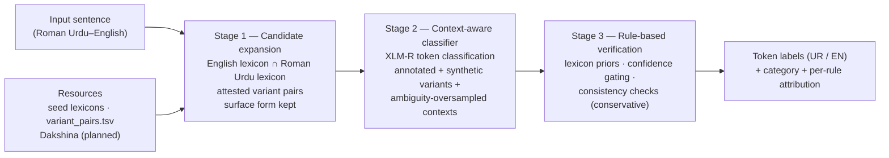

# Ru–En Token-Level LID — Variation-Aware, Ambiguity-Aware Pipeline

**Iteration 1 — implementation of the proposed methodology.**
This repository turns the proposed pipeline (candidate expansion → context-aware classifier → rule-based
verification) into working code and demonstrates it end-to-end on a small hand-labelled slice.

---

## 1. Topic and problem statement

Roman Urdu is Urdu written in the Latin script with no fixed spelling standard. In Roman Urdu–English
code-mixed text, token-level language identification (labelling every word as Urdu or English) is hard for
two distinct reasons that prior work never separates:

- **Cross-lingual lexical ambiguity** — one form, two languages: *main* ("I" / English *main*), *band*
  ("closed" / musical band), *is*, *to*.
- **Orthographic variation** — one word, many spellings: *nahi / nai / nhi*, *hai / he / hy*.

Existing studies show LID degrades on code-mixed input but do not isolate either error source, so errors
cannot be attributed to a cause and every downstream code-mixing analysis rests on unmeasured label error.
The proposed pipeline targets both, and reports error shares **per cause** (ambiguity / spelling variation /
their overlap).

## 2. What this iteration implements

| Stage | Proposal step | Status in this repository |
|---|---|---|
| 1 | Candidate expansion (surface form kept, readings attached, never rewritten) | **Working** — lexicons, attested variant pairs, four-category taxonomy, per-token candidate sets |
| 2 | Context-aware classifier (fine-tuned multilingual encoder) | **Training code + smoke mode** — token-classification training, synthetic romanization augmentation, ambiguity oversampling, inference wrapper |
| 3 | Rule-based verification (priors, confidence gating, consistency) | **Working** — conservative rules with per-token action log |
| 4 | Evaluation (per-category metrics, error attribution, CMI) | **Working** — metrics module + report script + MixLID baseline adapter |

Stages 1, 3 and the evaluation harness run on the **Python standard library alone** — no GPU, no
downloaded models. Stage 2 requires `torch`/`transformers` (Python 3.10–3.12) and a training run; see §7.

## 3. Architecture



## 4. Repository layout

```
ruen-lid-pipeline/
├── README.md                  # this file
├── METHODOLOGY_TO_CODE.md     # required step → file/function mapping
├── requirements.txt           # Stage-2 training dependencies
├── data/
│   ├── README.md              # dataset links, licences, roles
│   ├── fetch_data.py          # downloads into data/cache (never committed)
│   ├── resources/             # seed English + Roman Urdu lexicons, variant_pairs.tsv
│   └── demo/seed_labels.csv   # hand-labelled demo slice (12 sentences / 51 tokens)
├── src/
│   ├── candidate_expansion/   # Stage 1
│   ├── classifier/            # Stage 2 (dataset, augment, train, predict)
│   ├── verification/          # Stage 3
│   ├── eval/                  # metrics + baseline adapters
│   └── pipeline.py            # end-to-end CLI
├── scripts/
│   ├── evaluate.py            # token-level evaluation + markdown report
│   └── train_poc.py           # Stage-2 entry point (dry-run / smoke / real)
├── tests/test_pipeline.py     # 11 unit tests (stdlib unittest)
└── results/seed_results.md    # evaluation output of this iteration
```

## 5. Setup

**Stages 1/3/CLI/evaluation — no setup required** (Python ≥ 3.10, standard library only).

**Stage 2 training** needs a virtualenv on Python 3.10–3.12 (PyTorch has no wheels for 3.14 yet):

```bash
python3.12 -m venv .venv
source .venv/bin/activate
pip install -r requirements.txt
```

## 6. Quick start

```bash
# End-to-end pipeline on the running example (heuristic fallback: no checkpoint yet)
python3 -m src.pipeline --text "Delivery to time pe hui but box band nhi tha, main bht upset hoon, is bar bhi same issue he."

# Unit tests (11 tests)
python3 -m unittest discover -s tests

# Evaluation on the hand-labelled demo slice -> results/seed_results.md
python3 scripts/evaluate.py --out results/seed_results.md

# Data pipeline + augmentation statistics (no torch required)
python3 scripts/train_poc.py --dry-run

# Known datasets, licences and download status
python3 data/fetch_data.py --list
```

Example pipeline output (fallback mode, abbreviated):

```
token      category    readings   label  conf  rules
Delivery   standard    EN         EN     0.9
band       ambiguous   EN/band    EN     0.3
nhi        variant     nahi       UR     0.4
bar        both        EN/baar    UR     0.4
he         both        EN/hai     UR     0.4
```

## 7. Stage-2 training (proof of concept)

The training pipeline is complete and language-agnostic. For this iteration it is validated on **proxy,
publicly available token-level LID data** because no Roman Urdu–English corpus carries word-level LID labels
(that is exactly why the proposal schedules a manual annotation phase). The proxy run proves the machinery
(data loading → augmentation → training loop → checkpoint → inference); an RU–EN checkpoint follows the
annotation phase.

```bash
# Proxy token-level LID data (Hi-En, COMI-LINGUA; Git-LFS, ~123 MB)
python data/fetch_data.py --dataset comi-lingua-lid --yes-large

# Smoke run: tiny random checkpoint, 10 steps — validates the full loop end-to-end
python scripts/train_poc.py \
  --train data/cache/comi-lingua-lid/LID_train.csv \
  --valid data/cache/comi-lingua-lid/LID_test.csv \
  --smoke

# Real run (XLM-R as proposed; MuRIL is the documented alternative)
python scripts/train_poc.py \
  --train data/cache/comi-lingua-lid/LID_train.csv \
  --valid data/cache/comi-lingua-lid/LID_test.csv \
  --model xlm-roberta-base --epochs 3

# Inference with a trained checkpoint
python3 -m src.pipeline --text "kal office jana hai" --checkpoint checkpoints/ruen-lid
```

**Augmentation (proposal §7.2):** spelling variation is synthesized rule-by-rule
(`src/classifier/augment.py:synthetic_variants`), while ambiguity cannot be synthesized and is covered by
oversampling real sentences that contain known ambiguous forms (`oversample_ambiguous`). The dry-run prints
both statistics.

## 8. Evaluation protocol

Implemented in `src/eval/metrics.py`:

- token accuracy and macro-F1, overall and **per category** (standard / ambiguous / variant / both);
- **error share by cause** — what fraction of errors sit on ambiguous tokens, on variant tokens, and on
  their overlap;
- **CMI** (Gambäck & Das, 2014) with the length normalization `100·(1−Σpₗ²)/(1−1/n)`;
- baseline adapters (`src/eval/baselines/`): the model-free fallback, plus an off-the-shelf **MixLID**
  adapter (2026 token-level LID model; its label inventory has `urd_Arab` but **no `urd_Latn`**, so it
  cannot label Latin-script Urdu — the adapter reports this failure mode).

## 9. Results — iteration 1 (demo slice, fallback mode)

From `results/seed_results.md` (12 sentences, 51 tokens; **demo, not a thesis result**):

| Metric | Value |
|---|---|
| Token accuracy | 0.8235 |
| Macro F1 | 0.7984 |
| CMI (gold labels, corpus-level) | 38.75 |
| Errors | 9 |

| Category | Tokens | Accuracy | Macro F1 |
|---|---|---|---|
| standard | 34 | 1.0000 | 1.0000 |
| variant | 6 | 1.0000 | 1.0000 |
| both | 3 | 0.6667 | 0.4000 |
| ambiguous | 8 | 0.0000 | 0.0000 |

| Cause | Share of all errors |
|---|---|
| ambiguity | 88.89% |
| both (ambiguity × variation overlap) | 11.11% |

**Interpretation.** With no trained classifier (heuristic fallback + Stage-3 rules), every standard and
spelling-variant token is labelled correctly, and the entire residual error sits on cross-lingual
ambiguous tokens and their overlap. That is precisely the error source the Stage-2 context classifier is
trained to resolve — the attribution the proposal promises, visible even in fallback mode.

## 10. Proof-of-concept scope, deviations and limits

Documented deviations, each deliberate and justified:

1. **Stage 2 is validated on proxy data** (COMI-LINGUA, Hindi–English, Devanagari). It proves the training
   machinery, not RU–EN performance: script-specific features do not transfer to Latin-script Roman Urdu.
   Target-language training requires the seed annotation from the proposal's P1–P2 phase.
2. **Heuristic fallback** is used by the CLI/evaluation until a checkpoint exists: variants → UR,
   ambiguous → EN (low confidence), then Stage-3 rules run. The fallback is clearly labelled in output
   and is not presented as the methodology's classifier.
3. **Variant pairs are attested (seeded)** rather than mined at scale; `cluster_variants` (UrduPhone-style
   phonetic clustering) is included as the discovery tool for expanding `variant_pairs.tsv` with Dakshina
   attestations.
4. **Seed lexicons are compact** (hundreds of words). Production runs point the loader at full English and
   Roman Urdu lexicons (`--resources` / custom files).
5. **Stage-2 training was not executed in the author's current environment** (Python 3.14; PyTorch wheels
   unavailable). The script, smoke mode and data plumbing are executable on Python 3.10–3.12 as shown in §7.
6. **MixLID baseline adapter is included but not executed** here (requires `transformers`); it is the
   planned modern baseline, and its missing `urd_Latn` label is itself evidence for the research gap.

## 11. Datasets

See [`data/README.md`](data/README.md) for the full table (roles, licences, links). No corpus is
redistributed; `fetch_data.py` downloads into the git-ignored `data/cache/`.

## 12. Methodology → code mapping

The required step-by-step mapping table lives in [`METHODOLOGY_TO_CODE.md`](METHODOLOGY_TO_CODE.md).

## 13. Roadmap (next iterations)

1. Annotation guidelines and pilot annotation with per-category κ (proposal P1).
2. Full annotation of the RU–EN evaluation sample (P2).
3. Replace seed lexicons with full lexicons + Dakshina attestation mining.
4. Train the XLM-R classifier on the annotated RU–EN data (P3).
5. Run baselines (off-the-shelf tools, MixLID, LLMs) and the ablation ladder (P5–P6).
6. Error-share-by-cause and CMI-band analysis; report per-category results (P6).

## 14. References

- Rafae et al., *A clustering framework for lexical normalization of Roman Urdu*, Natural Language Engineering, 2021.
- Benton et al., *Improving informally romanized language identification*, EMNLP, 2025.
- Sheth et al., *COMI-LINGUA: Expert annotated large-scale dataset for multitask NLP in Hindi-English code-mixing*, Findings of EMNLP, 2025.
- Gambäck & Das, *On measuring the complexity of code-mixing*, ICON, 2014.
- Hong et al., *MixLID: Token-level language identification in mixed-language text*, 2026 ([model](https://huggingface.co/nlpai-lab/MixLID)).
- Burchell et al., *Code-switched language identification is harder than you think*, EACL, 2024.
- Kargaran et al., *MaskLID: Code-switching language identification through iterative masking*, ACL, 2024.
- Kitamura et al., *Doppelganger-JC: Benchmarking LLMs' understanding of cross-lingual homographs*, IJCNLP-AACL, 2025.
- Jamil & Rafi, *Code-switching as a safety failure mode in large language models*, AbjadNLP, 2026.
