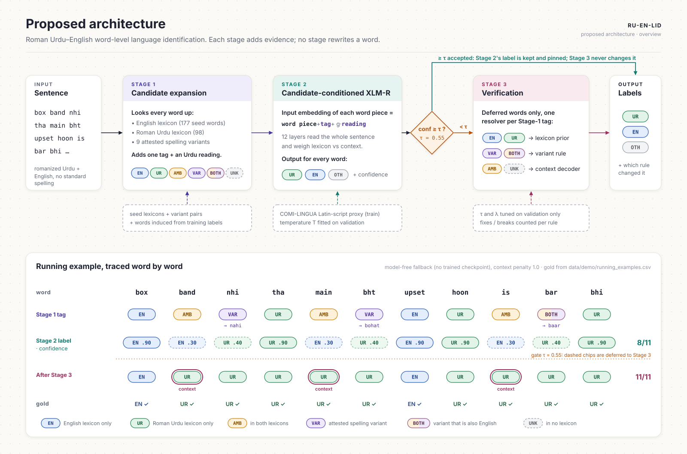
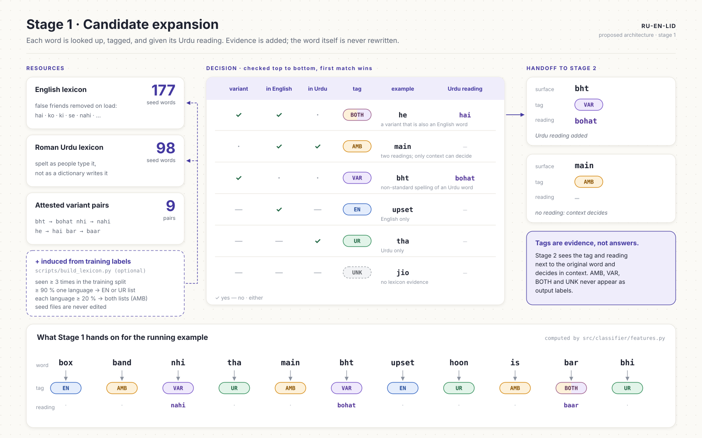
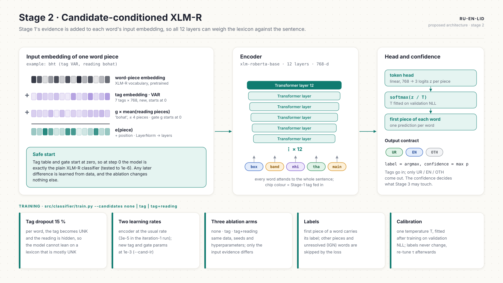
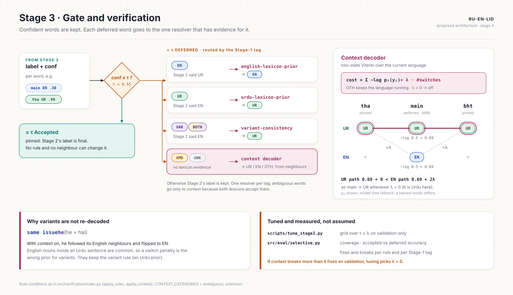

# Proposed architecture

Four diagrams of the RU-EN-LID pipeline as implemented on `main`. They are generated from the code by
`scripts/make_architecture_diagrams.py`, so the lexicon sizes, τ and the running-example trace come from
the pipeline itself. Re-run the script after changing either; `png/` holds 2× copies for slides.

Colours stay fixed across all four: indigo = Stage 1, teal = Stage 2, plum = Stage 3, amber = the
confidence gate. Tag chips: EN blue, UR green, AMB amber, VAR violet, BOTH half amber / half violet
(a variant that is also English), UNK grey dashed.

## Overview

The whole pipeline, with the running example traced word by word: 8 of 11 words correct after
Stage 2, 11 of 11 after Stage 3 (model-free fallback, so the confidences are illustrative).

## Stage 1 · Candidate expansion

Lexicon lookup, the fixed decision order that assigns one of six tags, and what is handed to Stage 2.

## Stage 2 · Candidate-conditioned XLM-R

How the tag and the Urdu reading enter the input embedding, why step 0 equals plain XLM-R, and the
training choices.

## Stage 3 · Gate and verification

The confidence gate, one resolver per Stage-1 tag, and the context decoder worked through on
*tha main bht*.

